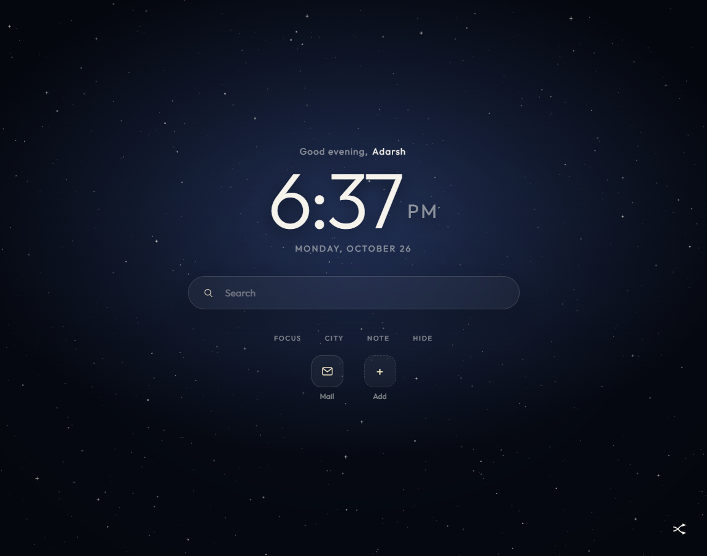
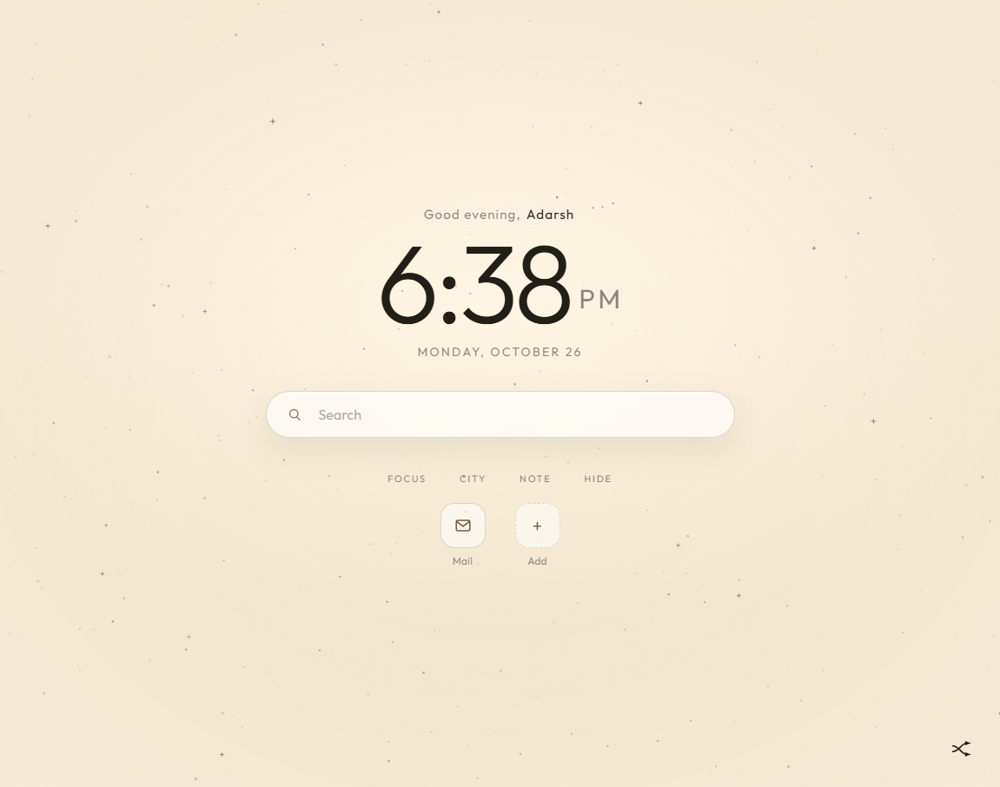
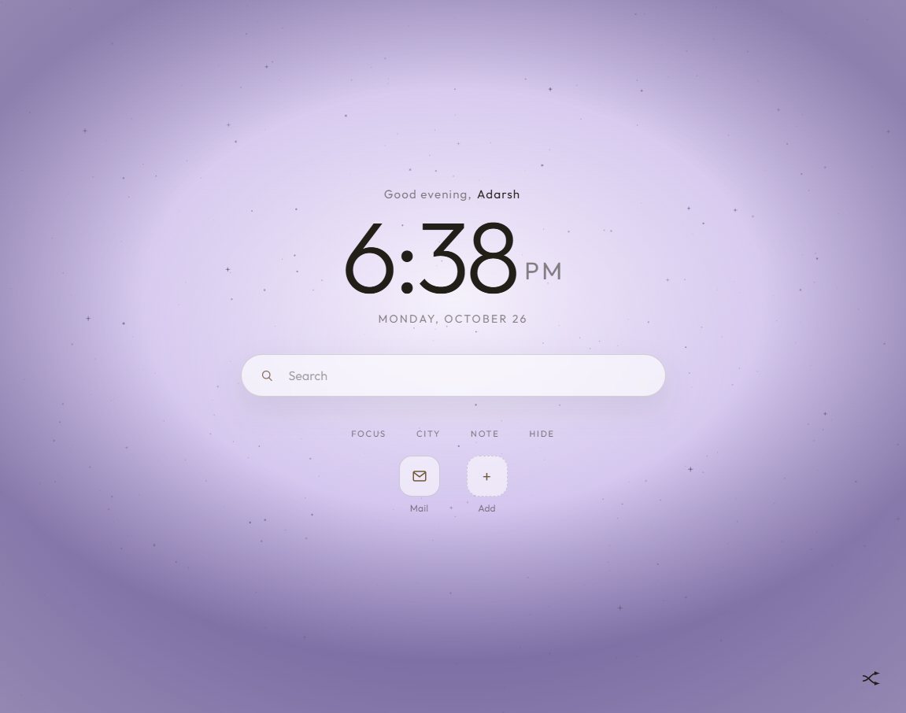
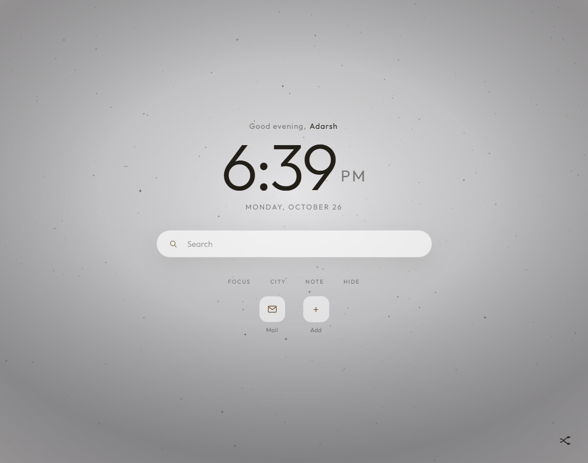
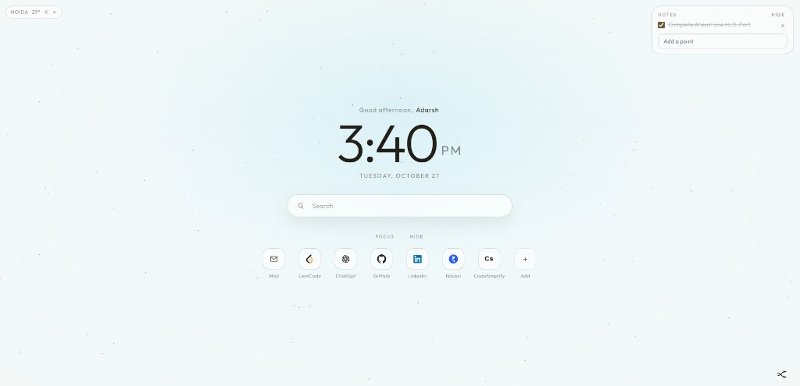
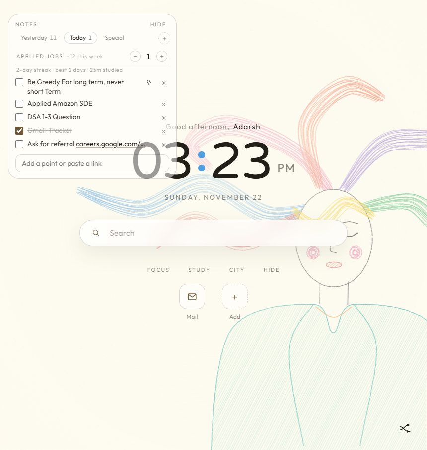

# New Tab

A minimal Chrome new-tab page: a clock, Google search, bookmarks, weather, notes by day, an applied-jobs counter, a study timer, and 130 wallpapers. 30 of them are hand-drawn colored-pencil art. The shuffle button picks one at random and will not repeat the wallpaper already on screen.

This is for local use. Clone the repo on any computer, load the folder in Chrome, and open a new tab.

## Screenshots

Night



Day



Soft violet



Grey



Pale



Wind girl, one of the colored-pencil wallpapers



## Install on another computer

1. Install [Git](https://git-scm.com/) and Google Chrome.
2. Clone this repo:

```bash
git clone https://github.com/GeeksAdarsh/ChromeExtension-WallpaperTheme.git
```

3. Open Chrome and go to `chrome://extensions`.
4. Turn on **Developer mode**.
5. Click **Load unpacked**.
6. Select the cloned `ChromeExtension-WallpaperTheme` folder. The folder you select must contain `manifest.json`.
7. Open a new tab.

Your name, notes, city, and bookmarks stay in Chrome on that computer. They are not inside the Git repo, so a new computer starts empty. To move them, click the extension icon, choose **Download backup**, and use **Restore from file** on the other computer. The default name is Adarsh. Click the name to change it.

When the files change, open `chrome://extensions` and click the reload icon on **New Tab**.

## How to use it

- **Shuffle** sits at the bottom right. Click it for a random wallpaper. One click never repeats the current color. Hover it to see **Auto**: click Auto for a new wallpaper on each tab, once a day, or light by day and dark at night.
- **Search** uses Google. A web address such as `mail.google.com` opens that site.
- **Mail** is the first bookmark. **Add** creates another. **Hide** puts every bookmark away, including Add. **Bookmarks** brings them back.
- **City** is one line: the name, the temperature, and a small sun, cloud, or rain mark in the same color as the text. × hides the chip and keeps the city.
- **Note** keeps a tab for each day: Today, Yesterday, then dates. A new day starts at 4 AM.
  - Click the words to edit them. Tick a point when it is done. × on a point deletes only that point. **Hide** closes the card and keeps everything.
  - Paste a link and it shows as a short clickable name.
  - The pin keeps a note on every day.
  - The arrow copies a note from an old day into Today. **Copy unticked to Today** copies all unfinished ones at once.
  - The bell brings a note back into Today tomorrow, in 3 days, in 1 week, or in 2 weeks.
  - **+** makes your own list, such as Special. It stays until you delete it with ×.
  - Drag tabs and notes to change their order.
  - Drag the card's edge or corner to resize it. Double-click the corner to reset the size.
- **Applied jobs** counts with + and −. Beside it is the total for this week. Below are your streak, your best run of days, and the study time for that day.
- **Study** turns the big clock into a countdown: 25 min, 45 min, 1 hr, 1.5 hr, or your own minutes. Everything else still works. The minutes are saved on that day.
- **Focus** leaves the clock, search, and shuffle, and hides the rest. **Exit** brings them back.
- Drag the city chip or the notes card to any corner. Near an edge, they snap and stay there.

There are 130 wallpapers:

- **100 soft colors** with no hard line across the page, including navy, cream, peach, meadow, petal, apricot, sea glass, honey, orchid, glacier, coral, violet, and 15 greys.
- **10 pencil designs**, such as Crayon wind, Scribble sun, Rainbow loop, Ribbon, and Kite clouds.
- **20 pencil characters**:
  - People: Wind girl, Flower crown, Rainy walk, Headphones, and Astronaut.
  - Animals: Sleepy cat, Peek cat, Little fox, Bunny, Balloon bear, Night owl, Penguins, Robin, Whale, and Koi pond.
  - Scenes: Butterflies, Mushrooms, House plants, Study desk, and Hot air balloons.

The pencil drawings sway very slowly. They stay still if your computer is set to reduce motion.

## Files

| File | Purpose |
| --- | --- |
| `manifest.json` | Chrome extension manifest |
| `newtab.html` | New tab page |
| `app.js` | Clock, search, bookmarks, notes, weather, wallpapers |
| `style.css` | New tab styles |
| `background.js` | Opens the guide from the toolbar icon |
| `extension.html` | Short guide, backup and restore, and version log |
| `guide.js` | Backup and restore |
| `icons/` | Extension icons |

Weather uses [Open-Meteo](https://open-meteo.com/). The city you type is sent there to fetch the temperature. Notes, bookmarks, and your name stay in the browser.
