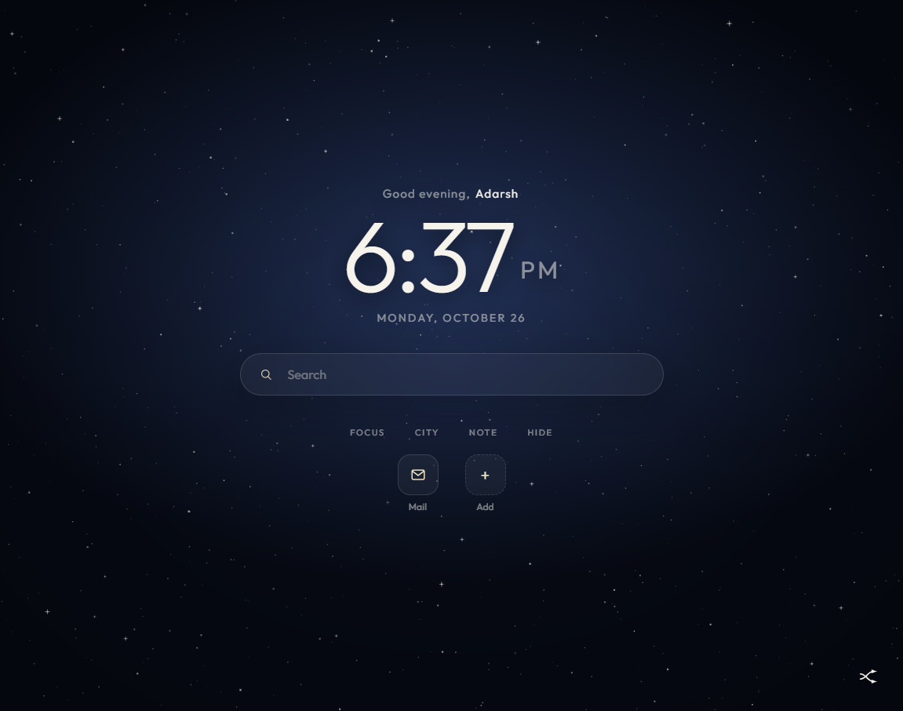
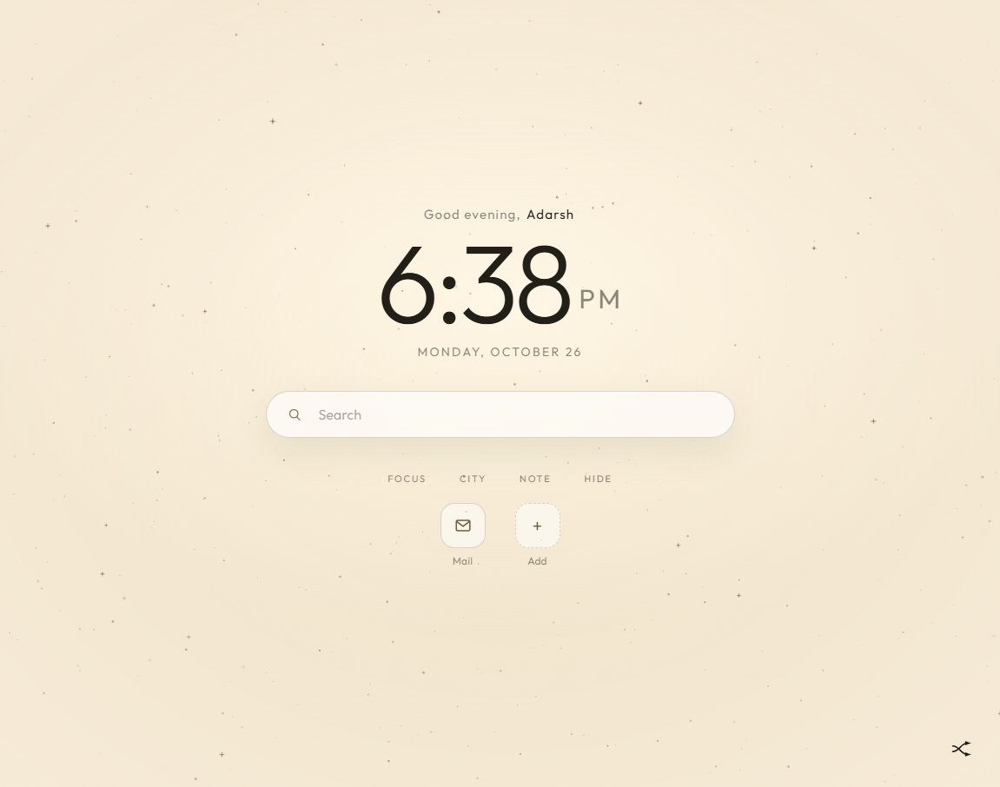
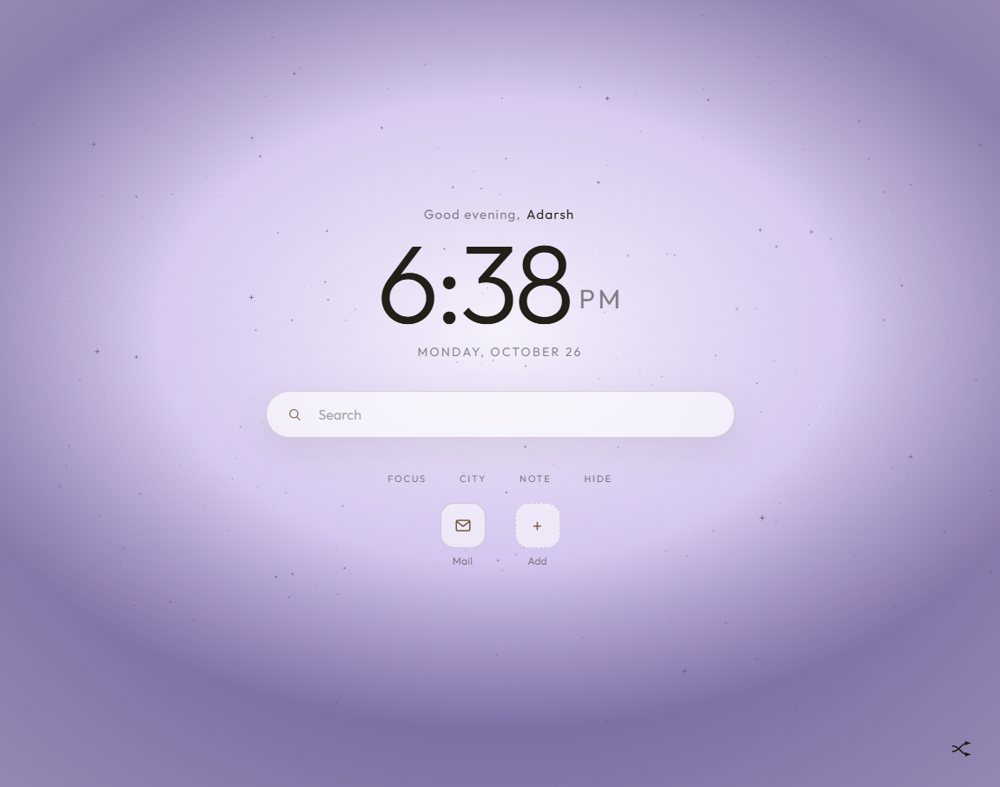
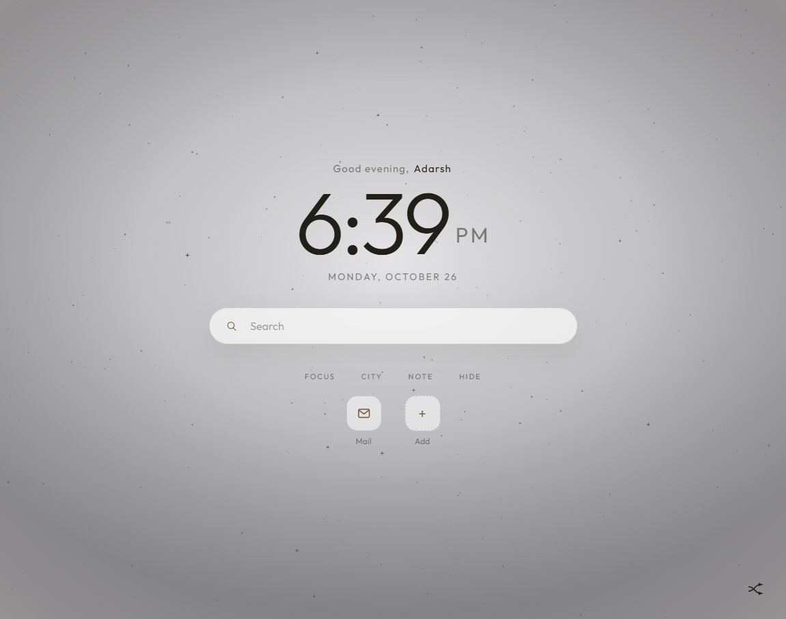
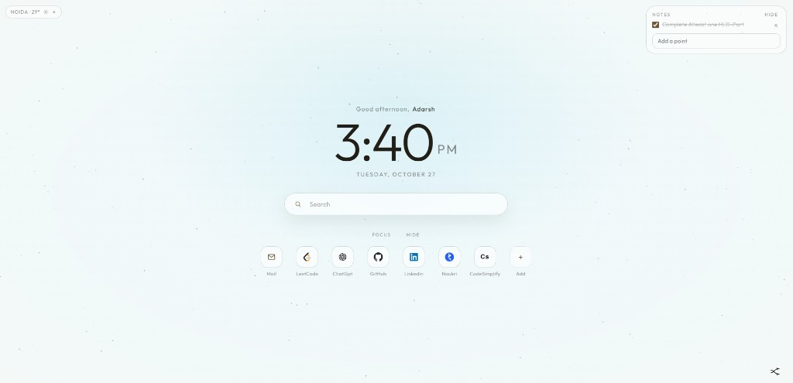

# New Tab

A minimal Chrome new-tab page: a clock, Google search, bookmarks, notes, weather, and 100 wallpapers. Each wallpaper is a different color. The shuffle button picks one at random and will not repeat the wallpaper already on screen.

This is for local use. Clone the repo on any computer, load the folder in Chrome, and open a new tab.

## Screenshots

Night



Day



Soft violet



Grey



Pale



## Install on another computer

1. Install [Git](https://git-scm.com/) and Google Chrome.
2. Clone this repo:

```bash
git clone https://github.com/GeeksAdarsh/ChromeExtension-WallpaperTheme.git
```

3. Open Chrome and go to `chrome://extensions`.
4. Turn on **Developer mode**.
5. Click **Load unpacked**.
6. Select the cloned `ChromeExtension-WallpaperTheme` folder. The folder you select must contain `manifest.json`.
7. Open a new tab.

Your name, notes, city, and bookmarks stay in Chrome on that computer. They are not inside the Git repo, so a new computer starts empty. After you add a note there, open another new tab and it stays. The default name is Adarsh. Click the name to change it.

When the files change, open `chrome://extensions` and click the reload icon on **New Tab**.

## How to use it

- **Shuffle** sits at the bottom right. Click it for a random wallpaper. The circle shows only while the pointer is over it. One click never repeats the current color.
- **Search** uses Google. A web address such as `mail.google.com` opens that site.
- **Mail** is the first bookmark. **Add** creates another. **Hide** puts every bookmark away, including Add. **Bookmarks** brings them back.
- **City** is one line: the name, the temperature, and a small sun, cloud, or rain mark in the same color as the text. × hides the chip and keeps the city.
- **Note** is a short list. Click the words to edit them. Tick a point when it is done. **Hide** closes the card and keeps what you wrote. × on a point deletes only that point.
- **Focus** leaves the clock, search, and shuffle, and hides the rest. **Exit** brings them back.
- Drag the city chip or the notes card to any corner. Near an edge, they snap and stay there.

There are 100 wallpapers. Each one is a soft color, with no hard line across the page. The set includes navy, cream, peach, meadow, petal, apricot, canopy, sea glass, honey, orchid, glacier, coral, violet, and 15 greys.

## Files

| File | Purpose |
| --- | --- |
| `manifest.json` | Chrome extension manifest |
| `newtab.html` | New tab page |
| `app.js` | Clock, search, bookmarks, notes, weather, wallpapers |
| `style.css` | New tab styles |
| `background.js` | Opens the guide from the toolbar icon |
| `extension.html` | Short guide and version log |
| `icons/` | Extension icons |

Weather uses [Open-Meteo](https://open-meteo.com/). The city you type is sent there to fetch the temperature. Notes, bookmarks, and your name stay in the browser.
